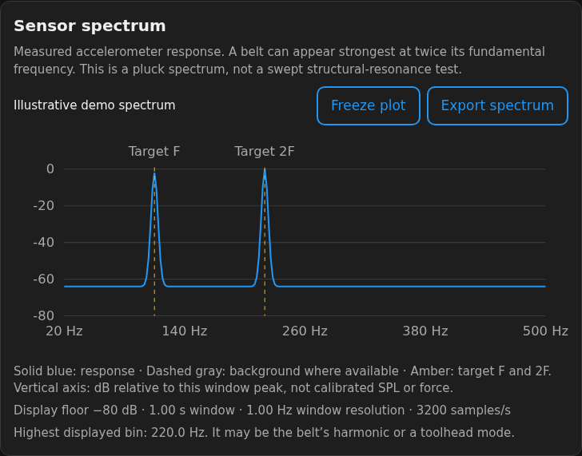

# Measurement reliability and the live spectrum

This change addresses specific ways a plausible-looking reading could be wrong.
It does not calibrate the accelerometer or establish absolute belt-force accuracy.

## What changed

### Check the sample clock before applying an FFT

An FFT treats samples as evenly spaced. Previously, monotonic timestamps were
accepted and a single average sample rate was calculated over the recording.
Missing samples could therefore shift the estimated frequency while still yielding
five apparently good plucks.

The analyzer now checks timestamp intervals. An interval greater than 1.5 times the
median interval rejects the capture as a sample gap. Maximum interval jitter greater
than 20% also rejects it. Smaller timing variation is interpolated onto a uniform
grid before analysis. Timestamped background recordings receive the same checks;
a background with a materially different rate is rejected.

These limits detect input-integrity problems. They are not a clock calibration.
The recordings are retained so you can inspect the original data after a rejection.

### Keep the exact estimate for decisions

The display still rounds frequency for readability. The accepted pluck estimates
and session mean retain their unrounded values for outlier checks, target comparisons
and repeatability statistics. A value outside tolerance cannot become complete
because rounding moved its displayed average inside the band.

### Require repeatability as well as a target match

For accepted frequencies, Chordata reports the sample mean, standard deviation,
spread and a nominal two-sided 95% Student-t interval for the mean. Completion
requires the full pluck count, usable analysis and this interval inside the target
band on both belts:

```text
abs(unrounded_mean - target) + repeatability_half_width <= tolerance
```

A mean can be on target while its interval crosses the tolerance. In that case,
repeat both belts; the software does not call the adjustment complete.

The calculation follows the usual [Student-t interval for a mean](https://www.itl.nist.gov/div898/handbook/eda/section3/eda352.htm).
Its assumptions include independent readings and roughly normal random variation.
The analyzer selects accepted plucks and can exclude outliers, so nominal 95%
coverage has not been demonstrated for this filtered population. The interval is a
conservative workflow check for repeatability, not calibrated uncertainty or a
95% guarantee of the true frequency. Shared errors from mounting, belt-span choice,
sensor clock and sensor calibration remain outside it.

## Reproducible before/after evidence

Run the deterministic synthetic benchmark:

```sh
.venv/bin/python tools/benchmark_reliability.py
```

The baseline defaults to commit `12c6a30566f1668875063da5ec0b338b0d4c0b11`, before
these changes. You can supply another local git revision with `--baseline-ref`.
The script executes the baseline analyzer from that revision; use revisions you
trust. Full recorded output is in [reliability-benchmark.json](reliability-benchmark.json).

| Fixture | Previous behavior | New behavior |
| --- | --- | --- |
| Clean 91 Hz capture, five plucks | Accepted as 91.0 Hz | Accepted; exact estimate about 91.000 Hz |
| Same source, 100 ms of samples missing | Accepted as 89.9 Hz, five plucks | Rejected as a sample gap |
| Bounded timestamp jitter | Accepted as 91.0 Hz | Accepted after uniform-grid resampling |
| Stable series centered on target | Complete | Complete |
| Series centered on target but spanning 109.6–110.4 Hz | Complete | Repeatability interval crosses tolerance; repeat |
| Exact 109.78 Hz mean, 110.04 Hz target, 0.25 Hz tolerance | Rounded to 109.8 Hz and complete | Exact difference is 0.26 Hz; incomplete |

The last three rows are planner fixtures, not physical recordings. These regressions
show fewer false acceptances under specific synthetic conditions. They do not
measure real-world accuracy, false-rejection rates or general improvement percentages.

## Read the sensor spectrum



The screenshot uses illustrative demo data. Connected captures use sensor samples.

During a belt capture, **Sensor spectrum** shows the most recent 0.8 seconds of
actual accelerometer data, refreshed about once a second. It remains visible as a
captured window when recording ends. A new attempt clears the prior window.

- Horizontal axis: measured frequency, approximately 25–500 Hz, subject to sampling
  bandwidth. A peak can be the belt fundamental, its second harmonic, or a toolhead mode.
- Vertical axis: summed, Hann-windowed X/Y/Z power in dB relative to that window's
  peak. It is not calibrated sound pressure, acceleration PSD or belt force.
- Solid blue: sensor response. Dashed gray: background reference, when available,
  using the same window and normalization. The background can exceed 0 dB when
  the current window is quieter than the reference; the display expands upward.
- Amber markers: target F and target 2F. These are reference lines, not detected peaks.
- The metadata reports window length, sample rate, capture time and `1 / window`
  resolution. Zero-padding elsewhere in the estimator is not extra physical resolution.

The display retains at most 256 real FFT bins, preserving the highest response in
each display group. The lower display floor is −80 dB; export retains the transmitted
values. At a 0.8-second window the native bin spacing is about 1.25 Hz. A narrower
plucked-belt estimator can interpolate a peak, but that does not prove absolute
sub-bin accuracy.

**Freeze plot** holds the displayed window and its target markers while recording
continues. **Resume plot** returns to current data. **Export spectrum** downloads
frequency and relative power, plus the background trace if available. A disconnected
page or ended capture is labelled accordingly; it is not described as an ongoing
live measurement.

This is the response to manually plucking the belt. It is not a swept resonance
measurement or an input-shaper calibration run.

## Hardware validation still needed

A useful physical validation set needs repeated recordings from the same documented
span and position, a trustworthy independent frequency reference, multiple sensors
and mounting arrangements, and both normal and deliberately damaged/noisy captures.
Compare frequency bias, repeatability, octave errors, false acceptance, rejection
rate and capture integrity separately. Test on the actual printer host as well as
a desktop; the bounded spectrum limits data size but does not establish Pi performance.

Laya/Jev remains optional advisory interpretation. It does not supply these numerical
checks and cannot override the result's quality gate.
