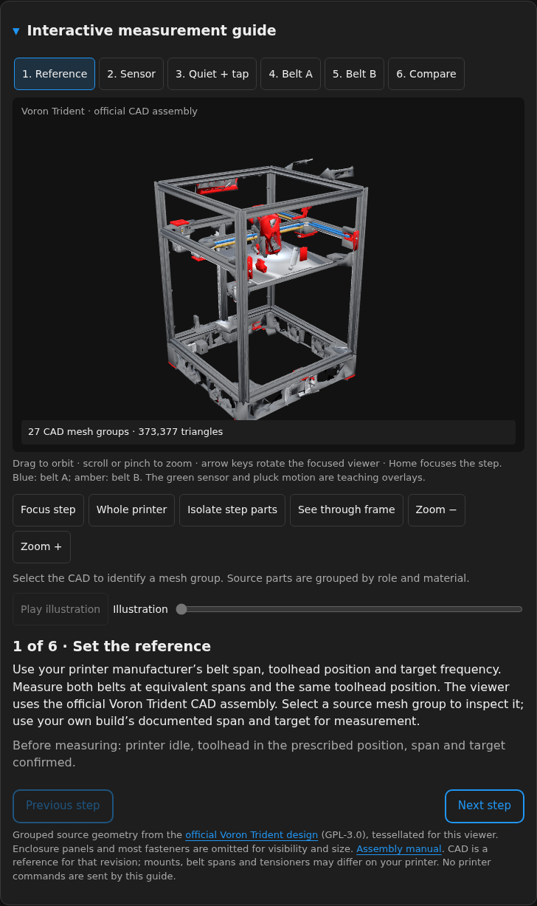
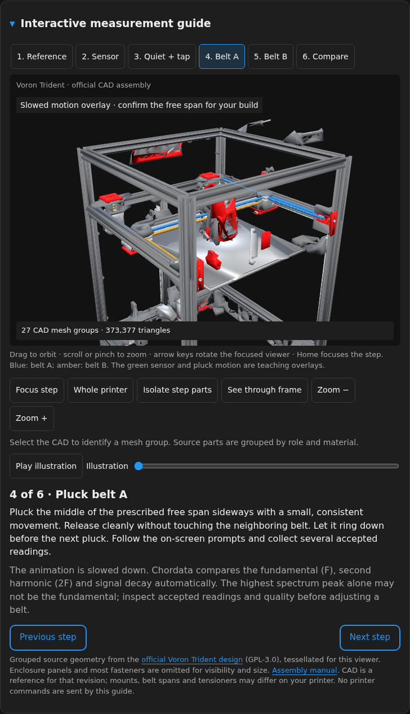

# Voron Trident interactive guide

Open **Interactive measurement guide** on the Chordata page. For an offline preview:

```sh
python3 -m http.server 8765 --bind 127.0.0.1 --directory web
```

Visit **http://127.0.0.1:8765/?demo&guide**. Demo readings and animation are illustrative.
The guide itself sends no printer commands and needs no AI service or external CDN.

The viewer loads a browser mesh converted from the official Voron Trident STEP
assembly, rather than a hand-built stand-in. The CAD is prepared offline and served
by the same Moonraker component as the page. Three.js and the loader are bundled
locally; opening the tutorial needs no separate viewer service or external CDN.
The model is loaded on demand when the guide is opened.





The Trident has a fixed top CoreXY gantry and a bed supported by three Z screws.
Its two belt paths are vertically stacked. The optimized mesh is for visual
instruction, not dimensional inspection or manufacturing. Follow the official
routing drawings, measurement position and target for your actual build.

## Controls

- Choose a step directly, or use **Previous step** and **Next step**.
- Drag the model to orbit. With the model focused, arrow keys rotate it, plus/minus
  zoom, and Home focuses the current step.
- Use **Play illustration** to watch the instructional action, or scrub its progress.
  The physical belt oscillation is slowed down so the transverse movement is visible.
- Use **Focus step** or **Whole printer** to switch between the current component
  and the complete assembly. **Isolate step parts** hides unrelated mesh groups;
  **See through frame** makes surrounding geometry transparent.
- Pause or collapse the guide when inspecting measurements. Animation also stops
  when hidden or outside the visible page. Reduced-motion preferences are respected.
- The written instructions remain available if canvas rendering is unavailable.

The six steps cover the documented target/span/position, sensor mounting, quiet
baseline and tap, belt A, belt B, and comparison followed by a fresh A/B measurement
after manual adjustment. Choose the actual measurement span from your printer guide;
the scene does not command the printer to match its illustrated position.

## Reference and attribution

The source CAD and instructional references are:

- [Voron Trident project and CAD](https://github.com/VoronDesign/Voron-Trident).
- [Official Trident assembly manual](https://github.com/VoronDesign/Voron-Trident/blob/main/Manual/Assembly_Manual_Trident.pdf),
  version 2026-06-24: frame, Z and XY assemblies; page 143 describes the stacked
  belt paths, and pages 148–154 show routing details.
- [Voron mechanical assembly documentation](https://docs.vorondesign.com/build/mechanical/).

Voron Trident is a Voron Design project, distributed under
[GPL-3.0](https://github.com/VoronDesign/Voron-Trident/blob/main/LICENSE).
The CAD source is pinned to commit
`f04f747d4dea06315806f352abf57f767cedf2b4`. The downloaded STEP archive has SHA-256
`9fe5a74f77048603e9289bdfcfa0db60b443252b9236ac3ef39821dc2a91209a`.
See [CAD conversion and viewer build](TRIDENT_CAD.md) for the source pipeline,
asset provenance, tessellation and optimization.

Three.js is distributed under the [MIT license](licenses/three-MIT.txt); the derived
Voron mesh follows the original design's GPL-3.0 license. This is an independent
Chordata tutorial, without a claim of Voron endorsement. No Behance artwork, mesh
or animation was copied.
